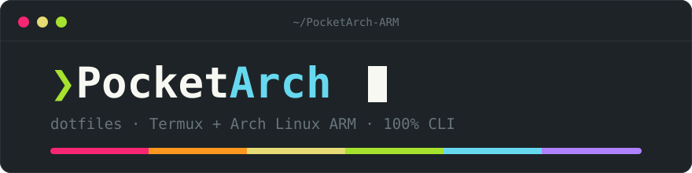
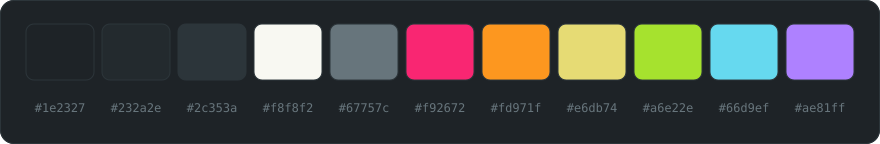

<div align="center">



[](https://archlinuxarm.org)

[](https://termux.dev)


Entorno de desarrollo Linux portátil, 100% CLI, sobre **Termux + Arch Linux ARM**
(PRoot, `aarch64` nativo, sin emulación). Minimalista, rápido, reproducible, y con
identidad visual **Material Monokai** en todas las herramientas.

Zsh + Starship · Neovim (LazyVim) · Tmux · Yazi · Lazygit · bat/eza/fzf/zoxide/rg/fd · Fastfetch

</div>


## ❯ Despliegue desde cero

### 1. Termux (host Android)

1. Instala [Termux desde F-Droid](https://f-droid.org/packages/com.termux/) (la
   versión de Play Store está desactualizada).
2. Instala una **Nerd Font** y la paleta de colores del terminal (los iconos
   de yazi/lazygit/starship necesitan la fuente): comandos completos en
   [docs/TERMUX.md](docs/TERMUX.md), §1.1 y §1.2.
3. Instala proot-distro y el contenedor. Arch mainline **no publica imagen
   ARM** (instalarlo por nombre falla); se usa el tarball oficial de
   **Arch Linux ARM** (detalles en docs/TERMUX.md, Parte 2):

```sh
pkg update && pkg install proot-distro
proot-distro install --override-alias arch-arm \
  http://os.archlinuxarm.org/os/ArchLinuxARM-aarch64-latest.tar.gz
proot-distro login arch-arm
```

### 2. Bootstrap mínimo (dentro del contenedor)

Solo lo imprescindible para poder clonar; `install.sh` re-hace estos pasos de
forma idempotente después.

```sh
# Keyring de Arch Linux ARM
pacman-key --init && pacman-key --populate archlinuxarm

# PRoot no tiene Landlock: sin esto pacman falla
grep -q '^DisableSandbox' /etc/pacman.conf || echo 'DisableSandbox' >> /etc/pacman.conf
sed -i 's/^DownloadUser/#DownloadUser/' /etc/pacman.conf

pacman -Syu --noconfirm git
```

### 3. Clonar y ejecutar el instalador

```sh
git clone https://github.com/AlMorRod/dotfiles.git ~/dotfiles
cd ~/dotfiles && ./install.sh
exec zsh
```

`install.sh` es **idempotente** (re-ejecutable sin romper nada): keyring,
pacman.conf, paquetes de `packages.txt` (`--needed`), symlinks vía stow, zsh
como shell por defecto y sync de plugins de Neovim.

### Estructura del repo (stow-friendly)

Cada carpeta de primer nivel — salvo `assets/` y `docs/`, que son material del
repo — es un "paquete" de [GNU Stow](https://www.gnu.org/software/stow/)
que replica la ruta desde `$HOME`; se enlaza con `stow -d ~/dotfiles -t ~ <paquete>`
(`install.sh` solo enlaza las carpetas que contienen `.config` o `.claude`).
Paquetes: `zsh` · `shell` · `starship` · `fastfetch` · `nvim` · `tmux` · `yazi` · `lazygit` · `git` · `bat` · `claude`.


## ❯ Capa Termux (host)

Este repo cubre solo la capa **Arch** (gestionada con `pacman` dentro del
contenedor). Todo lo que vive en la app Termux — Nerd Font, paleta de colores
del terminal, selector de entorno, manejo de imágenes, Claude Code opcional —
se gestiona con `pkg` y no es stow-able desde aquí, así que tiene documentación
propia: **[docs/TERMUX.md](docs/TERMUX.md)**. Si reinstalas Termux, esa guía es
lo que hay que rehacer antes de tocar este repo.


## ❯ Tips de uso

### Shell (zsh)

| Comando | Qué hace |
|---------|----------|
| `ls` / `ll` / `la` / `l` | eza con iconos, `-l --git`, ocultos, una columna |
| `cat` | bat (syntax highlight, tema Material Monokai) |
| `grep` | ripgrep |
| `z <parte>` / `zi` | salto zoxide a directorios frecuentes / interactivo |
| `update` | `pacman -Syu` **y regenera `packages.txt`** — úsalo en vez de pacman a pelo |
| `extract archivo [dest]` | extractor universal (tar.\*, zip, 7z, rar vía bsdtar) |
| `mkcd dir` | crea el directorio y entra |
| `weather [ciudad]` | clima compacto vía wttr.in |
| `backup archivo` | copia `archivo.AAAAMMDD-HHMMSS.bak` junto al original |
| `reels <link>…` | descarga y transcribe reels de Instagram ([media-transcribe](https://github.com/AlMorRod/media-transcribe)) |
| `yt <url> [--force]…` | descarga (mp4+mp3) y transcribe vídeos de YouTube |
| `dotfiles-sync-docs` | recopia los manuales del repo (`README`, `TERMUX`) al vault de Obsidian |

Historial: 50k entradas, deduplicado y compartido entre sesiones. La config
vive en archivos fuente (`aliases.zsh`, `functions.zsh`, `history.zsh`,
`exports.zsh`) bajo `~/.config/zsh/`, no en un `.zshrc` monolítico.

Los **alias y funciones portables** (compatibles con bash *y* zsh) viven en el
paquete `shell`: `~/.config/shell/aliases.sh` y `~/.config/shell/functions.sh`.
Los cargan tanto `~/.bashrc` como el `.zshrc` de zsh, así que funcionan en
cualquiera de los dos shells.

### Tmux

Prefix por defecto (`C-b`). Mouse activado, ventanas desde 1.

- `prefix + h/j/k/l` — moverse entre panes (estilo Vim)
- `prefix + H/J/K/L` — redimensionar panes (repetible)
- Barra inferior: sesión + ventanas + fecha/hora, paleta Material Monokai

### Yazi

- `g` `D` — ir a `~/dotfiles` · `g` `p` — ir a `~/project`
- `g` `l` — abrir **lazygit** en el directorio actual
- `Enter` sobre un archivo de texto lo abre en Neovim (`$EDITOR`)

### Neovim (LazyVim)

LSP/formatters vía Mason para Python (pyright+ruff), Bash, Markdown, JSON,
YAML y SQL (sqlfluff). Se instalan solos al abrir el primer archivo de cada
lenguaje. `<leader>gg` abre lazygit integrado; tema monokai-pro con la paleta
del proyecto.

### Mantenimiento

- **Toda config nueva entra al repo**: crea `dotfiles/<pkg>/.config/...`,
  enlaza con `stow <pkg>` y commitea. Nada de config "a mano" sin versionar.
- Instala paquetes con `pacman -S ...` y luego corre `update` (o
  `pacman -Qqe > ~/dotfiles/packages.txt`) para dejarlo registrado.
- Commits atómicos con mensaje claro: cada cambio de config reversible.
- Contenedor roto sin remedio: `proot-distro reset arch-arm` desde Termux y
  re-despliegue con esta guía (~10 min).


## ❯ Gotchas del entorno

- **No hay systemd** — nada de `systemctl`; los servicios se lanzan a mano.
- **pacman necesita `DisableSandbox`** — si tras reinstalar aparece un error
  de Landlock, es esto (install.sh ya lo deja configurado).
- **Keyring propio de Arch Linux ARM** — las firmas vienen de `archlinuxarm`,
  no del keyring de Arch estándar. Si pacman rechaza firmas en un contenedor
  nuevo: `pacman-key --init && pacman-key --populate archlinuxarm`
  (install.sh lo hace si falta).
- **Mason en ARM funciona** — pyright, ruff, bashls, marksman, etc. tienen
  builds `aarch64`. Si un binario de Mason falla raro, la causa histórica no
  fue falta de soporte ARM sino **contaminación del `PATH` con el toolchain
  de Termux** (binarios bionic del host). Asegúrate de que `gcc`, `make` y
  `python` resuelvan a los del contenedor (`command -v gcc` → `/usr/bin/gcc`).
- **Batería/temperatura no existen en el contenedor** — los sensores viven en
  Termux (termux-api); fastfetch los omite a propósito.
- **La Nerd Font es de Termux**, no del contenedor: un icono que no renderiza
  se arregla en la app, no aquí.
- **marksman (LSP Markdown)** necesita `DOTNET_GCHeapHardLimit`; ya viene
  configurado en `nvim/lua/plugins/lang-markdown.lua`.


## ❯ Paleta



Material Monokai, mapeada a mano (no existe port oficial). Fuente única de
verdad: la tabla en `CLAUDE.md` del proyecto PocketArch. Fondo `#1e2327`,
texto `#f8f8f2`, acentos `#f92672` / `#fd971f` / `#e6db74` / `#a6e22e` /
`#66d9ef` / `#ae81ff`. Ninguna config de este repo introduce colores fuera
de esa tabla.

### Claude Code

El paquete `claude` instala el tema en `~/.claude/themes/material-monokai.json`.
La selección del tema vive en `~/.claude.json` (no versionado): tras un
despliegue nuevo, dentro de Claude Code corre `/theme` y elige **Material
Monokai** (paso manual, una sola vez). Los fondos de diff y los colores de
subagentes se quedan con los del preset `dark` base: la paleta no tiene
variantes oscuras tintadas para esos roles.
