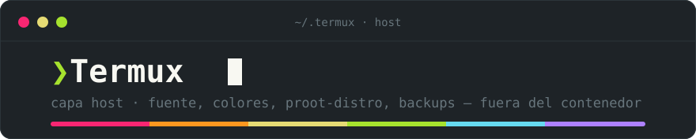

<div align="center">



</div>

Todo lo que vive **fuera** del contenedor `arch-arm`, en la app Termux.

Las configs de esta capa **no** se versionan en el repo (viven en la app, se gestionan con `pkg` y no son stow-ables); lo único versionado es este documento. Si reinstalas Termux, esto es lo que hay que rehacer — por eso está documentado aparte.

---

## ❯ Las dos capas

| Capa | Gestor | Qué controla |
|------|--------|--------------|
| **Termux** (esta) | `pkg` | Fuente, colores del terminal, proot-distro, backups |
| **Arch PRoot** (`arch-arm`) | `pacman` | El entorno de desarrollo: zsh, nvim, tmux, yazi, etc. |

Regla mental: **si se ve o se arranca, es Termux. Si se usa, es Arch.**
Los colores y la fuente los renderiza Termux, aunque el programa corra dentro de Arch. Por eso `eza`, `bat` y `fastfetch` obedecen a esta capa, no a la otra.


# ❯ Parte 1 — Configuración de Termux

## 1.1 Fuente (Nerd Font)

Sin Nerd Font, los iconos de eza, fastfetch, starship y yazi salen como cuadros vacíos.

```bash
pkg install -y curl unzip

mkdir -p ~/.termux ~/nf && cd ~/nf
curl -L -o CascadiaCode.zip \
  https://github.com/ryanoasis/nerd-fonts/releases/latest/download/CascadiaCode.zip
unzip -o CascadiaCode.zip

# El nombre exacto del .ttf cambia entre versiones: lo buscamos.
find . -iname '*NerdFontMono-Regular.ttf' -exec cp {} ~/.termux/font.ttf \;

cd ~ && rm -rf ~/nf
termux-reload-settings
```

Verificar:

```bash
ls -lh ~/.termux/font.ttf
echo "󰣇   "        # si ves cuadros vacíos, la fuente no cargó
```

Notas:
- El archivo se llama `CascadiaCode.zip` (con *c*, la fuente original de Microsoft), pero la fuente parcheada dentro se llama **Caskaydia Cove** (con *k* — Nerd Fonts renombra por licencia). No busques "CaskaydiaCode.zip", no existe.
- El archivo **debe** llamarse `font.ttf`. Termux no lee ningún otro nombre.
- Si el `find` no encuentra nada, lista lo extraído y copia a mano el `.ttf`. La variante *Mono* alinea mejor los iconos.
- Si Nerd Fonts renombra el asset, el `curl` falla; entonces baja el zip a mano.

---

## 1.2 Paleta de colores (Material Monokai)

Los 16 colores ANSI los define **Termux**, no el contenedor. Este archivo es lo que alinea `eza`, `bat`, `fastfetch` y todo lo que use ANSI con la identidad visual del proyecto.

Crear `~/.termux/colors.properties`:

```properties
background=#1e2327
foreground=#f8f8f2
cursor=#f8f8f2

color0=#1e2327
color1=#f92672
color2=#a6e22e
color3=#e6db74
color4=#66d9ef
color5=#ae81ff
color6=#66d9ef
color7=#f8f8f2
color8=#67757c
color9=#f92672
color10=#a6e22e
color11=#fd971f
color12=#66d9ef
color13=#ae81ff
color14=#66d9ef
color15=#f8f8f2
```

Aplicar con `termux-reload-settings` (o cerrar y reabrir Termux).

Notas:
- Mapeo derivado a mano de Material Monokai; **no es un port oficial**.
- `color11` va a naranja (`#fd971f`). Si en `ls` la columna de usuario resulta chillona, cámbialo a `#e6db74`.
- *Termux:Styling* da temas desde un menú, pero trae Monokai clásico (`#272822`), no el material. Escribe en este mismo archivo por debajo; si lo usas, sobrescribe después.

---

## 1.3 Alias y selector de entorno

Al abrir Termux, pregunta a qué entorno ir. **Arch por defecto tras 5 segundos**, para no pagar fricción diaria por una decisión que casi siempre es la misma.

Termux no trae `~/.bashrc`: hay que crearlo.

```bash
# PocketArch — atajo para entrar a Arch en cualquier momento
alias arch='proot-distro login arch-arm'

# PocketArch — ¿existe el contenedor?
_pa_has_arch() {
  command -v proot-distro >/dev/null 2>&1 || return 1
  proot-distro list -q 2>/dev/null | grep -qx 'arch-arm'
}

if [ -t 0 ] && [ -z "$POCKETARCH_NO_PROMPT" ] && _pa_has_arch; then
  _pink=$'\e[38;2;249;38;114m'
  _green=$'\e[38;2;166;226;46m'
  _cyan=$'\e[38;2;102;217;239m'
  _dim=$'\e[38;2;103;117;124m'
  _bold=$'\e[1m'
  _r=$'\e[0m'

  printf '\n'
  printf '   %s%s󰣇  PocketArch%s\n\n' "$_bold" "$_pink" "$_r"
  printf '   %s%s  Arch%s  %s(arch-arm)%s\n' "$_bold" "$_cyan" "$_r" "$_dim" "$_r"
  printf '   %s%s  Termux%s %slocal%s\n\n' "$_bold" "$_green" "$_r" "$_dim" "$_r"
  printf '   %s󰔟  Arch en 5s · pulsa %sn%s %spara quedarte local%s\n\n' "$_dim" "$_r$_green" "$_r$_dim" "$_dim" "$_r"
  printf '   %s❯%s ' "$_pink" "$_r"

  read -r -t 5 -n 1 _env
  printf '\n'
  case "$_env" in
    n|N) printf '   %s  Termux local%s\n\n' "$_green" "$_r" ;;
    *) clear; proot-distro login arch-arm ;;
  esac
  unset _env _pink _green _cyan _dim _bold _r

elif [ -t 0 ] && [ -z "$POCKETARCH_NO_PROMPT" ]; then
  printf '\n   \e[38;2;103;117;124m󰣇  arch-arm no encontrado · ver TERMUX.md §2.2\e[0m\n\n'
fi

unset -f _pa_has_arch
```

Notas:
- **Valida que `arch-arm` exista** antes de preguntar: si no hay contenedor, muestra un aviso tenue y te deja en local. Sin errores durante el setup inicial.
- `POCKETARCH_NO_PROMPT=1` lo desactiva puntualmente (escotilla de escape).
- El alias `arch` queda siempre disponible para entrar sin menú.
- Si el shell por defecto de Termux fuera zsh, el snippet va en `~/.zshrc`.
- Probar sin cerrar Termux: `bash -i`


# ❯ Parte 2 — Imágenes

## 2.1 Cómo funcionan las imágenes en proot-distro

En la versión **5.4.0** hay dos formas de instalar:

1. **Por nombre** → `proot-distro install ubuntu:24.04`
   Resuelve contra el registro **OCI/Docker**. Depende de que la imagen publique build para tu arquitectura.
2. **Por URL de tarball** → `proot-distro install <url.tar.gz>`
   Cualquier rootfs comprimido. Es la vía que usa PocketArch, con la imagen oficial de Arch Linux ARM.

> ⚠ **No existe un comando que liste las distros instalables.** `proot-distro list` solo muestra las que ya tienes. El catálogo "disponible" es, en la práctica, lo que haya en el registro OCI o el tarball que le des.

Y el detalle que muerde en ARM:

```
proot-distro install archlinux
[!] No image found for architecture 'arm64'. Available Linux platforms: amd64
```

Arch mainline **solo existe para x86_64**. Correrlo en el teléfono exige `qemu-user-x86-64` (emulación → lento y come RAM). Por eso PocketArch usa **Arch Linux ARM (ALARM)**, `aarch64` nativo, desde su tarball oficial.

---

## 2.2 Descargar e instalar (Arch Linux ARM)

```bash
pkg install -y proot-distro

proot-distro install --override-alias arch-arm \
  http://os.archlinuxarm.org/os/ArchLinuxARM-aarch64-latest.tar.gz
```

- `--override-alias arch-arm` le da nombre limpio (si no, lo nombra por la URL).
- Verás un aviso de que la integridad no se puede verificar: **esperado** con imágenes externas, no es un fallo.
- La URL es `http` a propósito: el certificado TLS del mirror solo cubre `archlinuxarm.org`, no el subdominio `os.` — con `https` la descarga falla por hostname mismatch (verificado 2026-07). No lo "corrijas".

---

## 2.3 Verificar qué tienes

```bash
# Contenedores instalados
proot-distro list

# Solo los nombres, uno por línea (útil en scripts)
proot-distro list -q

# ¿Es nativo o emulado?
proot-distro login arch-arm -- uname -m      # debe decir: aarch64

# Dónde vive el rootfs (5.4.0)
ls $PREFIX/var/lib/proot-distro/containers/

# Cuánto ocupa
du -sh $PREFIX/var/lib/proot-distro/containers/arch-arm

# Espacio libre en Termux
df -h $HOME
```

> La ruta cambió: versiones antiguas usaban `installed-rootfs/`, la 5.4.0 usa `containers/`. Si un tutorial te da la vieja, no la busques — usa `find $PREFIX -type d -name arch-arm`.

---

## 2.4 Bootstrap obligatorio (tras instalar)

Dentro del contenedor, **antes de instalar nada**:

```bash
# 1. Llaves de ALARM (usa su propio keyring, no el de Arch mainline)
pacman-key --init
pacman-key --populate archlinuxarm

# 2. pacman falla bajo PRoot por Landlock: desactivar el sandbox
sed -i 's/^DownloadUser/#DownloadUser/' /etc/pacman.conf
grep -q '^DisableSandbox' /etc/pacman.conf || echo 'DisableSandbox' >> /etc/pacman.conf

# 3. Ahora sí
pacman -Syu
```

Si te saltas el **1**, cualquier `pacman -S` falla por firma.
Si te saltas el **2**, falla con `restricting filesystem access failed because Landlock is not supported by the kernel`.

---

## 2.5 Backup

Se hace **desde Termux**, nunca desde dentro del contenedor.

```bash
termux-setup-storage          # una sola vez, crea ~/storage/downloads

proot-distro backup --output ~/storage/downloads/arch-arm-$(date +%F).tar.gz arch-arm
```

> ⚠ Verifica la sintaxis con `proot-distro backup --help` antes de confiar: las banderas cambian entre versiones.

**El backup del contenedor NO incluye la capa Termux.** Guárdala aparte:

```bash
tar czf ~/storage/downloads/termux-config-$(date +%F).tar.gz -C ~ .termux .bashrc
```

Eso preserva `font.ttf`, `colors.properties` y el selector.

---

## 2.6 Restaurar, resetear, borrar

```bash
# Restaurar desde un backup
proot-distro restore ~/storage/downloads/arch-arm-2026-07-08.tar.gz

# Volver el contenedor a estado recién instalado (destructivo)
proot-distro reset arch-arm

# Eliminarlo por completo (destructivo, irreversible)
proot-distro remove arch-arm
```

`reset` y `remove` **borran todo lo no versionado**. Antes de cualquiera de los dos: confirma que tu repo de dotfiles esté pusheado.

---

## 2.7 Imagen vs receta

No confundir dos cosas que suenan igual:

- **`~/dotfiles` + `install.sh` (dentro de Arch)** → la **receta**. Versionada, legible, evoluciona. Es cómo se replica PocketArch de verdad.
- **`proot-distro backup` (tar.gz)** → el **paracaídas**. Foto opaca y pesada de un momento. Sirve si el contenedor se corrompe y no quieres reconstruir.

La receta es el plan. La imagen es el respaldo. No sustituyas una por la otra.


# ❯ Parte 3 — Primeros pasos con Claude Code *(opcional)*

## 3.1 Por qué lo agregamos

PocketArch funciona perfectamente sin esto. Se añadió por una razón concreta: **evitar hacer el trabajo dos veces.**

El entorno se puede configurar a mano, siguiendo una guía y editando cada archivo con `nano`. Pero entonces la config queda escrita suelta en `~/.config`, y luego hay que rehacerla para meterla en el repo de dotfiles. Config a mano ≠ config reproducible.

Claude Code ejecuta las fases del plan escribiendo cada archivo **directo en `~/dotfiles`** y enlazándolo con `stow`. Un solo flujo: configurado y versionado a la vez. Además el contenedor es aislado y desechable (`proot-distro reset`), así que darle permisos amplios tiene un costo bajo.

Es opcional: si prefieres configurar a mano, salta esta parte y trabaja siempre dentro del repo de dotfiles.

---

## 3.2 Instalación (dentro del contenedor)

Node viene de `pacman`; Claude Code de `npm`:

```bash
pacman -S nodejs npm
node --version                          # debe ser >= 18

npm install -g @anthropic-ai/claude-code
claude --version
claude doctor                           # verifica node, ripgrep, red y auth
```

Notas:
- **Sin `sudo`**: en PRoot ya eres root, y `npm -g` escribe sin problema.
- ALARM es **glibc**, así que el ripgrep incluido funciona sin workarounds.
- Actualizar: `npm install -g @anthropic-ai/claude-code@latest`

---

## 3.3 Permisos como root

Como root, `--dangerously-skip-permissions` **está bloqueado por diseño**. Los permisos amplios se configuran en `~/.claude/settings.json`: allowlist en modo `acceptEdits`, con `deny` contra borrados catastróficos.

Ese archivo es global del contenedor: aplica desde cualquier carpeta.

---

## 3.4 Primer arranque

Requiere cuenta de pago (Pro, Max, Team o API).

```bash
mkdir -p ~/project/PocketArch
cd ~/project/PocketArch
claude
```

El primer lanzamiento abre autenticación: imprime una URL, la abres en el navegador del teléfono y pegas el código.

En esa carpeta van `CLAUDE.md` (contexto y permisos del contenedor) y `PocketArch-plan.md` (fases y estado). Claude Code lee el `CLAUDE.md` automáticamente al trabajar ahí.

---

## 3.5 Nota de reproducibilidad

Claude Code es un paquete **npm-global, no pacman**: **no aparece en `packages.txt`**.
Debe ir explícitamente en el `install.sh` del repo de dotfiles, o reconstruirás un entorno sin la herramienta que lo construyó.


# ❯ Gotchas de esta capa

- **Plugins de Termux (`Termux:API`, `Termux:Styling`) deben venir de la misma fuente que Termux** (F-Droid o donde lo instalaste). Si no, fallan por firma.
- **Sensores (batería, temperatura)** requieren la app `Termux:API` + el paquete `termux-api`. Viven aquí, **no** en el contenedor. Por eso Fastfetch dentro de Arch no los muestra.
- **`qemu-user-x86-64`** solo hace falta para contenedores x86 emulados. Con `arch-arm` nativo es innecesario: `pkg uninstall qemu-user-x86-64`.
- **Fastfetch reporta el disco del host Android** (`erofs [Read-only]`), no el del contenedor. Artefacto de PRoot, no un fallo.


# ❯ Reinstalación desde cero (checklist)

1. Instalar Termux + plugins desde la misma fuente.
2. `pkg install -y proot-distro curl unzip`
3. `termux-setup-storage`
4. Fuente y colores: restaurar `~/.termux/` desde el tar, **o** rehacerlos con 1.1 y 1.2.
5. `termux-reload-settings`
6. Contenedor: `proot-distro restore <backup.tar.gz>` **o** instalarlo limpio (2.2) + bootstrap (2.4).
7. Dentro del contenedor: clonar el repo de dotfiles y correr `install.sh`.
8. *(Opcional)* Claude Code (3.2) y su `settings.json` de permisos (3.3).
9. Alias + selector de entorno en `~/.bashrc` (1.3).
